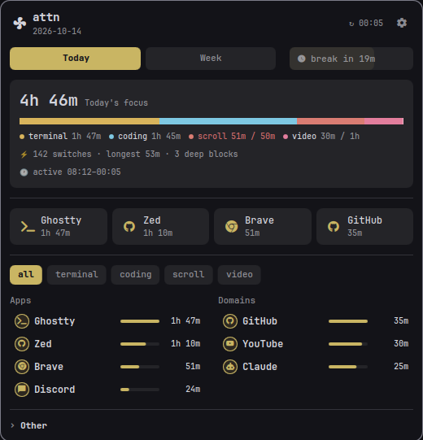
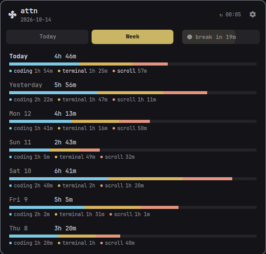
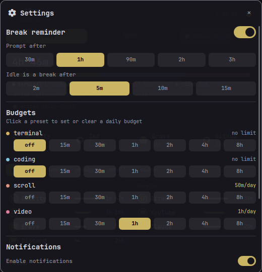
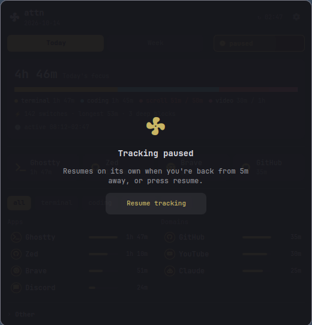

# attn

A local attention ledger for Wayland ([niri](https://github.com/YaLTeR/niri), [Hyprland](https://hyprland.org/), [Sway](https://swaywm.org/), [river](https://codeberg.org/river/river)) and [Quickshell](https://quickshell.org/).

`attn` records where your focus actually goes: which apps, which domains inside the browser, which video really plays. It only observes — no blocking, no scores. It keeps the evidence locally, shows a small indicator in your bar, and can notify you when a break is overdue or a daily budget runs out.



| Week | Settings | Paused |
|:----:|:--------:|:------:|
|  |  |  |


## What it tracks

- **App focus time** from your compositor IPC. Auto-detected; override with `focus_source.kind`.
- **Terminal subprocess.** Run `claude` inside `ghostty` and the time goes to `claude`, not `ghostty`. Detection uses the window title, a per-window cache, a live tmux query, then a `/proc` walk.
- **Browser domain time** for the Chromium family (Helium, Brave, Chrome, Chromium) and the Firefox family (Firefox, Zen, LibreWolf, Floorp). Domain time only grows while that browser holds focus.
- **Video playback** through MPRIS, so a two-hour film counts as two hours instead of one navigation event. It counts only while the playing browser has focus and the tab sits on a known video domain.
- **Focus metrics**: context switches, longest unbroken stretch, 25-minute deep-work blocks, the day's work window.
- **Idle capping.** A focused interval that never changes stops counting after 5 minutes, so an unattended tab cannot inflate the day.

## What it does not do

No blocking. No gating. No interventions. No cloud sync. No telemetry. No per-tab live tracking. No AI summaries. No streaks or scores.

The only unprompted thing it does is one desktop notification, for an overdue break or a spent daily budget. Both are opt-in and one config line turns them off. It is a notebook, not a coach.

## How it works

**[ARCHITECTURE.md](./ARCHITECTURE.md)** covers the data model and SQLite schema, focus attribution, terminal-subprocess resolution, how browser and MPRIS time clips to real focus, the socket API, and the failure modes. Read it before you change the code, or when a number looks wrong.

## Privacy

All state stays local. The SQLite ledger sits at `~/.local/state/attn/attn.sqlite` (mode 0600), the Unix socket at `$XDG_RUNTIME_DIR/attn.sock` (user only). The daemon snapshots browser history, reads the copy, then deletes it — it never touches your live browser database. There is no network code path.

## Install

### One-line installer (Linux, x86_64 or aarch64)

You need a supported Wayland compositor running: niri, Hyprland, Sway or river. Without one, app tracking does nothing.

```sh
curl -fsSL https://raw.githubusercontent.com/0xPD33/attn/main/scripts/install.sh | sh
```

It fetches the latest GitHub Release tarball, verifies its sha256, installs the binary to `~/.local/bin/attn`, runs `attn init` (or `--merge`), and writes `~/.config/systemd/user/attn.service`. It does **not** enable or start the service unless you set `ATTN_START=1`.

| Environment override | Effect |
|---|---|
| `ATTN_VERSION=v0.1.0` | pin a release tag |
| `ATTN_PREFIX=$HOME/bin` | install somewhere else |
| `ATTN_SYSTEMD=0` | skip the systemd unit |
| `ATTN_START=1` | enable and start the service straight away |
| `ATTN_SKIP_COMPOSITOR_CHECK=1` | install without a supported compositor |

Check it with `attn --help` and `attn doctor`.

### As a Nix flake

```nix
# flake.nix
{
  inputs.attn.url = "github:0xPD33/attn";
  inputs.attn.inputs.nixpkgs.follows = "nixpkgs";

  outputs = { home-manager, attn, ... }: {
    homeConfigurations.you = home-manager.lib.homeManagerConfiguration {
      # ...
      modules = [
        attn.homeManagerModules.default
        ({ ... }: {
          programs.attn = {
            enable = true;
            daemon.enable = true;        # user systemd service
            quickshell.enable = true;    # install AttnIndicator.qml under ~/.config/quickshell/attn/
          };
        })
      ];
    };
  };
}
```

`programs.attn.configText` overrides the default config inline.

`programs.attn.quickshell.enable` installs the indicator only. If another Home Manager module owns your whole `~/.config/quickshell` tree, leave it disabled and copy the three files from `quickshell/` in by hand. They are self-contained on purpose — hardcoded colours, no imports beyond `QtQuick` and `Quickshell` — so they drop into any tree. Restyle your copy if you want, but keep that edit in your tree.

### Standalone build

```sh
nix develop
cargo build --release
install -m 0755 target/release/attn ~/.local/bin/
```

Or build the flake package directly:

```sh
nix build .#default
./result/bin/attn --help
```

## Configure

```sh
attn init                # write ~/.config/attn/config.toml from the bundled default
attn init --merge        # add new bundled defaults to an existing config
attn init --force        # overwrite
$EDITOR ~/.config/attn/config.toml
# the daemon reloads on save (mtime watch); `attn reload` is the manual nudge
```

The bundled default already covers the common app IDs and domains, so your own config only states the differences. Watch lists merge per category on top of the defaults; everything else replaces.

```toml
poll_interval_secs = 60
idle_after_secs    = 300
socket_path        = "$XDG_RUNTIME_DIR/attn.sock"
state_path         = "~/.local/state/attn/attn.sqlite"

[apps.watch]
coding   = ["code", "cursor", "zed"]
terminal = ["com.mitchellh.ghostty", "wezterm"]
chat     = ["discord", "signal", "slack"]

[domains.watch]
ai      = ["chatgpt.com", "claude.ai", "gemini.google.com"]
scroll  = ["reddit.com", "x.com", "tiktok.com"]
video   = ["youtube.com", "youtu.be", "twitch.tv"]

[browsers.brave]
app_ids       = ["brave-browser", "brave"]
history_paths = ["~/.config/BraveSoftware/Brave-Browser/*/History"]
kind          = "chromium"

[terminals]
poll_secs = 10

[terminals.apps]
ai     = ["claude", "codex", "aichat"]
editor = ["nvim", "vim", "hx", "helix", "emacs"]

[breaks]
enabled        = true
interval_secs  = 3600   # prompt after an hour of continuous focus
min_break_secs = 300    # 5 min of input idle counts as a break

[notifications]
enabled         = true  # false disables both notifications below
break_overdue   = true
budget_exceeded = true

[budgets.scroll]
daily_budget_secs = 1800   # amber past 30 min/day; 0 or absent means no budget
```

Breaks, budgets, notifications and the focus source are also editable from the popup settings sheet, or from `attn set-breaks`, `attn set-budget`, `attn set-notifications` and `attn set-focus-source`. The CLI rewrites `config.toml` in place and keeps your comments.

### Adding to the shipped lists

Want a category or domain added for everyone? The watch lists live in per-category text files, one item per line, `#` comments allowed:

- `config/apps/<category>.txt` — Linux app IDs and executable names
- `config/domains/<category>.txt` — domains for browser history matching

Edit the file, run `tools/sync-default-config.sh`, then open a PR. CI checks the regenerated `config/default.toml` still matches the sources.

Everything else (paths, intervals, browsers, terminals, breaks, notifications) lives in `config/runtime.toml`. `config/default.toml` is the generated union of both — the daemon embeds it at compile time and the Nix flake reads the same file, so never hand-edit it.

## Run

Set `programs.attn.daemon.enable = true` and Home Manager registers `attn.service` under your user:

```sh
systemctl --user status  attn
systemctl --user restart attn
journalctl --user -u attn -f
```

Or run `attn daemon` yourself.

## CLI

```
attn daemon              run the long-running collector
attn status --json       print current-day + 7-day status as JSON (used by Quickshell)
attn reload              reload ~/.config/attn/config.toml without restarting
attn init [--merge|--force]
                         write or update the default config
attn doctor              check config, state DB, focus source, wayland idle, dbus, browser DBs, socket
attn break-start         pause tracking
attn break-end           resume tracking
attn set-breaks     [--enabled=BOOL] [--interval=SECS] [--min-break=SECS]
attn set-budget     --category=NAME --secs=N          # 0 clears the budget
attn set-notifications [--enabled=BOOL] [--break-overdue=BOOL] [--budget-exceeded=BOOL]
attn set-focus-source --kind=auto|niri|hyprland|river|sway
attn categorize     --kind=app|domain --id=ID --category=NAME
attn export         [--since=YYYY-MM-DD] [--until=YYYY-MM-DD]
```

`attn export` writes the raw ledger as CSV to stdout, one row per app and domain interval, as `kind,started_at,ended_at,duration_secs,id,category,detail`. It reads the state DB directly, so it works while the daemon is stopped.

Abridged `status` output:

```json
{
  "date": "2026-05-12",
  "updated_at": "2026-05-12T22:30:00+02:00",
  "watch_seconds": 15563,
  "tracked_seconds": 16928,
  "media_seconds": 252,
  "video_watch_seconds": 252,
  "apps": [
    { "id": "claude",                 "seconds": 1094, "watched": true, "category": "ai" },
    { "id": "com.mitchellh.ghostty",  "seconds": 5285, "watched": true, "category": "terminal" }
  ],
  "domains": [
    { "domain": "github.com", "seconds": 372, "watched": true, "category": "coding" },
    { "domain": "youtube.com", "seconds": 252, "watched": true, "category": "video" }
  ],
  "categories": [
    { "name": "ai",       "seconds": 6979 },
    { "name": "terminal", "seconds": 5285 },
    { "name": "scroll",   "seconds": 2100, "budget_secs": 1800, "over_budget": true }
  ],
  "switch_count": 84,
  "longest_focus_secs": 4320,
  "deep_work_blocks": 3,
  "break_overdue": false,
  "paused": false
}
```

The real response also carries `days[]` (today plus the previous six), the `media` list, `uncategorized_apps` and `uncategorized_domains`, the break and notification settings, and the day's work window. ARCHITECTURE.md has the full shape.

## Quickshell widget

Three QML files under `quickshell/`:

- `AttnIndicator.qml` — the bar chip. Polls `attn status --json`, fast at first, then every 5 s. Dims when the data goes stale; pulses amber when a break is overdue or tracking is paused.
- `AttnPopup.qml` — the popup the chip opens. **Today** shows a stacked category bar with budget stripes, the focus-metrics line, top items, filter chips, and side-by-side Apps and Domains lists. Its **Other** drawer files an uncategorized item into a category in one click. **Week** shows the last 7 days as stacked bars. The gear icon opens the settings sheet.
- `AttnRow.qml` — the list row the popup uses.

`quickshell.enable = true` installs the indicator only, so wire the popup into your own bar yourself. The reference wiring lives in the home-manager Quickshell config that owns `Bar.qml` for this project.

## Development

```sh
nix develop
cargo test
cargo build --release
```

The tests cover focus resolution, terminal subprocess detection, browser snapshot reading, domain attribution, MPRIS gating, idle capping, pause transitions, config merging, the daily-totals rebuild, focus metrics, budgets, and notification dedup. They run against in-memory or temp-file SQLite.

## License

MIT. See [LICENSE](./LICENSE).
